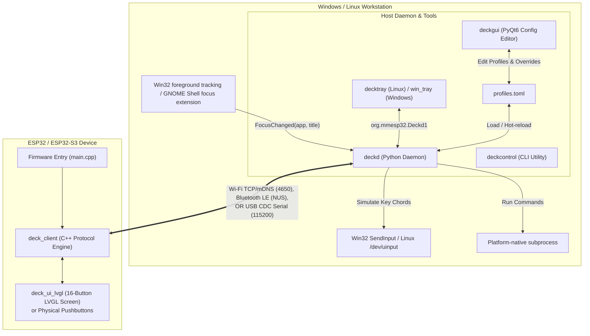

# Context-Aware Stream Deck — Windows-First Setup

An open-source, wireless, context-aware macro pad and Stream Deck system for **Windows** workstations, paired with embedded hardware (ESP32 / ESP32-S3). This branch is organized around Windows host setup; Linux host instructions remain below for Ubuntu and other supported distributions.

> **Windows Branch (`StreamDeck-windows`) Status**
> * **Included on Windows:** USB Serial (`--port auto` COM auto-detection), Wi-Fi TCP/mDNS (`4650` / `_mmdeckd._tcp`), a notification-area controller with sign-in startup and GUI shortcut, native Win32 keyboard injection and foreground-window tracking, detached shell actions, Windows Start Menu app discovery/launch, and GUI controls for daemon status, profile overrides, and USB/Wi-Fi transports.
> * **Not supported on Windows:** BLE GATT (BlueZ/Linux-only) and remote lock-screen unlock (blocked by Windows Secure Desktop).
> * See **[Windows Setup Guide (`docs/WINDOWS.md`)](docs/WINDOWS.md)** or jump straight to [Windows Quick Start](#step-1-host-installation-windows--usb--wi-fi) below.

## Windows Quick Start

On Windows 10/11 with Python 3.11 or newer, run this from the repository root in PowerShell:

```powershell
.\host\run-windows.ps1
```

The script installs the Windows dependencies, saves daemon options, registers the notification-area controller to start at sign-in, and checks whether `deckd` opened its local GUI-control listener. USB and Wi-Fi are enabled by default. See the [Windows Setup Guide](docs/WINDOWS.md) for firewall, COM port, and startup options.

Unlike conventional macro pads that only simulate key combinations blindly, this system maintains a **continuous two-way synchronization link** between your PC and the device. It automatically detects which application currently has window focus (e.g., VS Code, Firefox, Terminal, CAD), dynamically pushes the relevant button labels, icons, and colors to the device screen, and confirms every button action.

No external cloud services, bridges, or Raspberry Pi servers are required. The device communicates directly with the host running the daemon over **Wi-Fi (TCP / mDNS)**, **Bluetooth Low Energy (BLE)**, or **USB Serial**.

---

## Key Capabilities

* **Context-Aware Dynamic Switching:** As you switch windows, the deck adapts to the active application using native Win32 foreground tracking on Windows or the GNOME Shell D-Bus focus reporter on Linux.
* **Direct Peer-to-Peer Link:** Connects directly to the workstation running the daemon. No intermediate servers or Raspberry Pi gateways needed.
* **Triple Transport:**
  * **Wi-Fi (TCP / mDNS):** Connects over your local Wi-Fi network to `deckd` on TCP port 4650 with automatic `_mmdeckd._tcp` mDNS discovery, optional manual host IP override, and an on-screen **Wi-Fi Setup** screen (nearby network scanner, on-screen keyboard, and NVS credential persistence).
  * **Wireless Bluetooth LE (BLE):** Implements the standard Nordic UART Service (NUS) via BlueZ GATT.
  * **USB CDC Serial:** Plug-and-play over a standard USB-C cable at 115200 baud.
* **Two-Way Synchronization:**
  * **Host → Device:** Streams active window titles, group headers, button labels, icons, semantic color codes, and multi-page numbers.
  * **Device → Host:** Sends button presses with sequential tracking; the host confirms dispatch with `DECK ACK` or reports errors with `DECK ERR`.
* **Multi-Computer Scanning:** If you run the daemon on multiple computers (e.g., desktop and laptop), tap **Scan** on the device to discover all nearby hosts (`DeckD-<hostname>`) and switch target machines on the fly.
* **Multi-Page Grids & Portable App Launcher:** Supports multiple macro pages (`<` / `>`) plus a dedicated **App Launcher** grid (up to 72 apps, 24 per page), populated from Linux `.desktop` files or Windows Start Menu shortcuts and customized via `deckgui`, with a `< Back` button and optional auto-return after launching.
* **Profile Overrides:** Easily toggle between dynamic **Follow focus** and pinning a specific app layout using the touchscreen, desktop GUI, or platform tray controls.
* **System Tray Controls:** Linux uses the GTK-free D-Bus `StatusNotifierItem` applet (`decktray`); Windows uses a native notification-area controller with daemon lifecycle and GUI controls.
* **Visual Profile & Macro Editor (`deckgui`):** Full PyQt6/QtPy desktop configurator with an interactive 16-button preview, live keyboard shortcut recorder, and syntax-highlighted TOML editor.
* **Hardware Portability:** Clean PlatformIO firmware base that compiles for ESP32-S3 capacitive touch displays (LVGL 8.3), physical pushbutton matrices, or headless serial controllers.

---

## Architecture Overview



---

## Directory Structure

```
Stream_Deck/
├── README.md                      # This documentation
├── docs/
│   ├── PROTOCOL.md                # Complete DECK newline protocol specification
│   ├── HARDWARE_GUIDE.md          # Wiring, display setup, and board porting notes
│   └── WINDOWS.md                 # Windows setup guide
├── host/                          # Host daemon, Windows backend, tray, GUI, and services
│   ├── deckd.py                   # Core background daemon (Linux + Windows)
│   ├── win_platform.py            # Windows backend (Win32 SendInput, focus watcher, COM auto-detect)
│   ├── profiles.windows.toml      # Starter button profiles for Windows
│   ├── requirements-windows.txt     # Windows Python dependencies
│   ├── run-windows.ps1              # Windows setup, sign-in startup, and tray launcher
├── uninstall-windows.ps1        # Windows runtime uninstaller
│   ├── win_tray.py                  # Windows notification-area controller
│   ├── desktop_apps.py            # Portable Linux XDG .desktop app discovery & launch helpers
│   ├── ble_deck.py                # BlueZ BLE GATT server (NUS profile)
│   ├── decktray.py                # System tray status applet (pure D-Bus)
│   ├── deckgui.py                 # PyQt6 visual configuration editor
│   ├── deckcontrol.py             # CLI control utility
│   ├── profiles.toml              # Button profiles & action definitions
│   ├── requirements.txt           # Python dependencies
│   ├── install.sh                 # Automated installer script
│   ├── deckd.service.in           # Systemd user service unit template
│   ├── decktray.desktop.in        # Tray autostart launcher
│   ├── deckgui.desktop.in         # Desktop application launcher
│   ├── 99-deckd-uinput.rules      # udev rule for /dev/uinput permissions
│   ├── gnome-extension/           # GNOME Shell active window focus tracker
│   │   └── deckfocus@mmesp32/
│   ├── packaging/                 # Debian (.deb) package scripts
│   └── tests/                     # Automated test suite
└── firmware/                      # Device-side PlatformIO project
    ├── platformio.ini             # Multi-target build configuration
    ├── include/
    │   ├── deck_config.h          # Hardware configuration & transport flags
    │   ├── deck_client.h          # Protocol client & Wi-Fi config header
    │   ├── deck_ui_lvgl.h         # LVGL touchscreen UI header
    │   └── lv_conf.h              # LVGL 8.3 widget/memory configuration
    ├── src/
    │   ├── main.cpp               # Setup, loop, and hardware integration
    │   ├── deck_client.cpp        # Protocol parser, USB/Wi-Fi/BLE transports, NVS & AP scan
    │   └── deck_ui_lvgl.cpp       # 16-button LVGL UI, App Launcher, and Wi-Fi Setup screen
    └── test/
        └── test_deck_parser.py    # Host-side unit test for protocol parser
```

---

## System Requirements

### Host (PC)
* **Windows (USB + Wi-Fi with GUI and app launcher):**
  * **OS:** Windows 10 or Windows 11.
  * **Connectivity:** Local Wi-Fi/LAN (TCP port `4650` + mDNS) and/or an available USB port (ESP32-S3 native USB CDC works with built-in drivers; CP210x/CH340 boards may need their standard USB-UART driver).
  * **Python:** Python 3.11+ (`winget install Python.Python.3.12` or python.org).
* **Linux (Full Feature Set):**
  * **OS:** Linux (Ubuntu 22.04+, Debian 12+, Fedora, Arch).
  * **Desktop Environment:** GNOME (Wayland or X11) recommended for automated focus tracking. Other desktop environments work with manual profile selection via the tray or GUI.
  * **Connectivity:** Local Wi-Fi/LAN (TCP port 4650 + mDNS), Bluetooth 4.0+ adapter (BlueZ) for BLE wireless mode, or an available USB port for wired serial mode.
  * **Python:** Python 3.10+ with `venv`.

### Target Device (Microcontroller)
* **MCU:** ESP32 or ESP32-S3 (with Bluetooth LE support).
* **Optional Display:** Capacitive touchscreen (e.g. CrowPanel 5.0"/7.0" ESP32-S3, CYD Cheap Yellow Display, Sunton ESP32-S3), or physical pushbuttons.
* **Build Tools:** [PlatformIO](https://platformio.org/) (CLI `pio` or the VS Code extension).

---

## Setup & Installation

### Step 1: Host Installation (Windows — USB + Wi-Fi)

1. **Run the PowerShell launcher from the repository root:**
   ```powershell
   .\host\run-windows.ps1
   ```
   *This creates `host\.venv-win`, installs the Windows dependencies, adds a StreamDeck shortcut to your user Startup folder, and starts a notification-area icon. The host starts automatically at sign-in. Use the icon menu to start, stop, restart, or quit the host, open the visual profile editor, or view the log. The daemon starts with USB (`--port auto`) and Wi-Fi (TCP 4650 + mDNS) enabled.*

2. **Optional flags:**
   ```powershell
   .\host\run-windows.ps1 --port COM4   # Pin a specific COM port
   .\host\run-windows.ps1 --no-usb      # Wi-Fi only (keeps COM port free for flashing)
   .\host\run-windows.ps1 --no-wifi     # USB only
   .\host\run-windows.ps1 --verbose     # Verbose logging (focus changes & protocol traffic)
   .\host\run-windows.ps1 -NoAutostart  # Do not start the tray automatically at sign-in
   .\host\run-windows.ps1 -NoLaunch     # Install/update without launching the tray now
   ```

   Running the script without daemon flags resets previously saved options to the defaults. After updating the daemon, use **Restart** in the existing tray menu; if `win_tray.py` itself changed, choose **Quit** and run the script again.

3. **Allow Wi-Fi through Windows Defender Firewall (one-time, Administrator PowerShell):**
   ```powershell
   New-NetFirewallRule -DisplayName "StreamDeck deckd" -Direction Inbound -Protocol TCP -LocalPort 4650 -Action Allow -Profile Private
   ```

4. **Customize your buttons:** Edit `host\profiles.windows.toml` (`deckd` hot-reloads changes automatically). Process matching uses lowercase `.exe` stems (e.g. `code`, `msedge`, `chrome`, `firefox`, `windowsterminal`). See [docs/WINDOWS.md](docs/WINDOWS.md) for full details.

5. **Uninstall the Windows runtime:** Run `.\host\uninstall-windows.ps1` from the repository root. It stops this checkout's daemon and tray, removes its Startup shortcut and `host\.venv-win`, and preserves `%LOCALAPPDATA%\StreamDeck`. Add `-PurgeData` to also delete settings, logs, and the optional unlock key. The source checkout is left in place.

---

### Step 1 (Linux): Host Installation (Linux Workstation)

#### Option A: Debian Package (Ubuntu 26.04 amd64 — Recommended)
Build and install the `.deb` package (see [host/packaging/README.md](host/packaging/README.md) for full details):
```bash
bash host/packaging/build-deb.sh 1.3.0 dist
sudo apt install ./dist/mmesp32-deckd_1.3.0_amd64.deb
sudo usermod -aG input,dialout "$USER"
```
Log out and back in, then run (without `sudo`):
```bash
deckd-user enable
```

#### Option B: Script Installer (From Source)
1. **Navigate to the host directory and run the installer:**
   ```bash
   cd host
   chmod +x install.sh
   ./install.sh
   ```
   *This automatically sets up a Python virtual environment in `host/.venv`, installs dependencies (`pyserial`, `evdev`, `dbus-next`, `zeroconf`, `cryptography`, `PyQt6`, `qtpy`, `tomli-w`), renders the systemd unit file, and configures the desktop launchers.*

2. **Configure `/dev/uinput` and USB Serial Permissions:**
   To simulate keyboard shortcuts and access USB serial without root permissions, install the udev rule and add your user to `input` and `dialout`:
   ```bash
   sudo install -m 0644 99-deckd-uinput.rules /etc/udev/rules.d/
   sudo udevadm control --reload-rules
   sudo modprobe uinput
   sudo udevadm trigger --name-match=uinput
   sudo usermod -aG input,dialout "$USER"
   ```
   *(Log out and back in to apply the group change)*

3. **Install and Enable the GNOME Shell Window Focus Extension:**
   ```bash
   mkdir -p ~/.local/share/gnome-shell/extensions
   rm -rf ~/.local/share/gnome-shell/extensions/deckfocus@mmesp32
   cp -r gnome-extension/deckfocus@mmesp32 ~/.local/share/gnome-shell/extensions/
   gnome-extensions enable deckfocus@mmesp32
   ```
   *(On Wayland, log out and back in once so GNOME Shell loads the newly copied extension)*

4. **Enable and Start the Daemon:**
   ```bash
   systemctl --user enable --now deckd.service
   ```
   Check daemon status:
   ```bash
   systemctl --user status deckd.service
   ```

5. **Start the System Tray Applet and Config GUI:**
   ```bash
   # Launch the tray applet (runs in background):
   ./.venv/bin/python decktray.py &

   # Launch the visual profile editor:
   ./.venv/bin/python deckgui.py &
   ```

---

### Step 2: Device Firmware Setup (PlatformIO)

> **Tip:** If `deckd` is already running, pause USB polling first (untick **USB** in the tray menu, or run `deckd-user release-usb` for .deb installs) so PlatformIO can access `/dev/ttyUSB0`.

The `firmware/` directory contains a modular PlatformIO project with 4MB-safe defaults for ESP32-S3 and classic ESP32 boards (see [docs/HARDWARE_GUIDE.md](docs/HARDWARE_GUIDE.md) for flash/PSRAM and driver notes).

Install PlatformIO into a local virtualenv (works on distros that block system-wide `pip`, PEP 668) and use `.venv/bin/pio` in place of `pio` below:

```bash
cd ~/StreamDeck/firmware          # from host/: cd ../firmware
python3 -m venv .venv
.venv/bin/pip install platformio
# Use .venv/bin/pio for every "pio ..." command below, e.g.:
.venv/bin/pio run -e esp32s3_crowpanel_7 -t upload
```

> **Note:** `esp32s3_crowpanel_7` builds on the pioarduino platform (Arduino-ESP32 3.x / ESP-IDF 5.5) with NimBLE-Arduino 2.x; the first build downloads that toolchain automatically.

#### Environment 1: Elecrow CrowPanel 7.0" ESP32-S3 (`esp32s3_crowpanel_7` — Default, Out-of-the-Box)
Complete turnkey firmware for the CrowPanel 7.0" ESP32-S3 (800×480 double-buffered RGB LCD, PCA9557 + GT911 capacitive touch, LVGL 8.3 UI, and NimBLE/USB/Wi-Fi protocol engine):
```bash
pio run -e esp32s3_crowpanel_7 -t upload
```
* **What happens:** The panel boots directly into the full 16-button LVGL touch interface, scans for `DeckD-<hostname>` over BLE (or switches to USB/Wi-Fi via the on-screen transport dropdown), and renders your active profile and App Launcher.

#### Environment 2: Custom ESP32-S3 Touchscreen Panels (`esp32s3_ble_touch`)
Generic LVGL 8.3 UI + protocol boilerplate for other ESP32-S3 panels (such as CrowPanel 5.0" or Sunton panels):
```bash
pio run -e esp32s3_ble_touch -t upload
```
* **Important:** Add your board's display and touch driver initialization under `firmware/src/boards/<panel>/` or in `firmware/src/main.cpp` right after `lv_init()`. Without a display driver registered, the firmware still boots safely and runs the BLE/protocol stack in headless mode.

#### Environment 3: Headless / Physical Pushbuttons over BLE (`esp32s3_ble_buttons`, `esp32_ble_buttons`)
Works out of the box on any ESP32-S3 or classic ESP32 devkit (uses GPIO 0 / onboard BOOT button by default, plus an interactive Serial CLI):
```bash
# ESP32-S3:
pio run -e esp32s3_ble_buttons -t upload

# Classic ESP32:
pio run -e esp32_ble_buttons -t upload
```
* **Interactive Serial CLI (115200 baud):**
  ```bash
  pio device monitor -b 115200
  # Type: status, scan, press 0, launcher 0, next, prev
  ```

#### Environment 4: Wired USB Serial (`esp32s3_serial`, `esp32_serial`)
Communicates directly with `deckd` over USB Serial at 115200 baud without Bluetooth:
```bash
# ESP32-S3:
pio run -e esp32s3_serial -t upload

# Classic ESP32:
pio run -e esp32_serial -t upload
```
* **Note:** USB Serial (`UART0`) carries the `DECK` protocol directly to `deckd`; close `pio device monitor` so `deckd` can open the port.

#### Testing the Firmware Parser Locally
You can test and verify the embedded protocol parsing logic on your PC with your native compiler:
```bash
python3 test/test_deck_parser.py
```

---

## Configuring Profiles (`profiles.toml`)

Profiles define what buttons appear and what actions they trigger. You can edit `host/profiles.toml` manually or use the graphical editor (`deckgui.py`).

### Profile Format

```toml
[profiles.default]
title = "Default Desktop"
group1 = "Quick Launch"
group2 = "Media & System"

# Row 1 (Buttons 0 - 7)
b0 = { label = "Terminal", icon = "terminal", color = "warn", action = "keys:Ctrl+Alt+T" }
b1 = { label = "Files",    icon = "folder",   color = "accent", action = "cmd:nautilus ~" }
b2 = { label = "Browser",  icon = "globe",    color = "accent", action = "cmd:xdg-open https://google.com" }
b3 = { label = "VS Code",  icon = "code",     color = "accent", action = "cmd:code" }
b4 = { label = "Copy",     icon = "copy",     color = "idle",   action = "keys:Ctrl+C" }
b5 = { label = "Paste",    icon = "paste",    color = "idle",   action = "keys:Ctrl+V" }
b6 = { label = "Screenshot", icon = "camera", color = "good",   action = "keys:Print" }
b7 = { label = "Lock",     icon = "lock",     color = "bad",    action = "keys:Super+L" }

# Row 2 (Buttons 8 - 15)
b8  = { label = "Play/Pause", icon = "play",   color = "good",   action = "keys:PlayPause" }
b9  = { label = "Mute",       icon = "mute",   color = "bad",    action = "keys:Mute" }
b10 = { label = "Prev Track", icon = "prev",   color = "idle",   action = "keys:PreviousSong" }
b11 = { label = "Next Track", icon = "next",   color = "idle",   action = "keys:NextSong" }
b12 = { label = "Vol +",      icon = "volup",  color = "good",   action = "keys:VolumeUp" }
b13 = { label = "Vol -",      icon = "voldown", color = "good",  action = "keys:VolumeDown" }
b14 = { label = "Sys Monitor", icon = "refresh", color = "warn", action = "cmd:gnome-system-monitor" }
b15 = { label = "Suspend",    icon = "power",  color = "bad",    action = "cmd:systemctl suspend" }

# Application-Specific Profile (Activated when matching window is focused)
[profiles.code]
match_app = "code"
title = "VS Code"
group1 = "Editor Navigation"
group2 = "Git & Terminal"

b0 = { label = "Command Palette", icon = "terminal", color = "accent", action = "keys:Ctrl+Shift+P" }
b1 = { label = "Go to File",      icon = "folder",   color = "accent", action = "keys:Ctrl+P" }
b2 = { label = "Format Doc",      icon = "code",     color = "good",   action = "keys:Ctrl+Shift+I" }
b3 = { label = "Toggle Terminal", icon = "terminal", color = "warn",   action = "keys:Ctrl+grave" }
b4 = { label = "Git Commit",      icon = "ok",       color = "good",   action = "keys:Ctrl+Enter" }
```

### Action Syntax
* `keys:<combination>`: Emulates keyboard shortcuts via Linux `/dev/uinput` or native Windows `SendInput`. Examples:
  * `keys:Ctrl+C`
  * `keys:Ctrl+Shift+P`
  * `keys:Super+L`
  * `keys:PlayPause`, `keys:VolumeUp`, `keys:Mute`
* `cmd:<shell_command>`: Executes a shell command or script in the background. Examples:
  * `cmd:nautilus ~/Downloads`
  * `cmd:systemctl suspend`
  * `cmd:spotify`
* `page:next` / `page:prev`: Navigates through multi-page layouts.
* `app = "<app_id>"` (or `shell = "..."` / `keys = "..."` in grouped profiles): Launches an installed application discovered for the current host. Linux uses XDG `.desktop` IDs such as `firefox.desktop`; Windows uses Start Menu IDs such as `startmenu:user:Accessories/Calculator.lnk`. Pick Windows apps from the GUI to get the correct ID.

### App Launcher Configuration (`[launcher]`)
When `[launcher]` is omitted or `apps` is empty, `deckd` automatically curates sensible default applications installed on the current host. Customize the launcher grid manually or via the **App Launcher** tab in `deckgui`:

```toml
[launcher]
auto_return = true   # true: return to Stream Deck page after launching; false: stay until < Back
apps = [
    { id = "firefox.desktop", label = "Firefox", icon = "globe", color = "accent" },
    { id = "org.gnome.Terminal.desktop", label = "Terminal", icon = "terminal", color = "good" },
]
```

### Built-in Semantic Colors
* `accent` (Cyan / Light Blue)
* `good` / `green` (Green)
* `warn` / `yellow` (Amber / Yellow)
* `bad` / `red` (Red)
* `idle` / `muted` (Slate / Dark Gray)
* Custom hex colors: `#RRGGBB` (e.g. `#89B4FA`)

---

## Operating the System

### The Host System Tray Applet (`decktray`)
The tray applet sits in your top bar and gives instant status:
* **Icon Status:** Green icon when an ESP32 is actively connected; gray icon when disconnected.
* **Status line:** Displays current connection (`WiFi · workstation`, `BLE · workstation`, or `USB · workstation`) and active profile.
* **Window Focus line:** Displays the current window class and title detected by GNOME Shell.
* **Follow focus:** Checked by default so layouts follow window focus automatically.
* **Pin Profile:** Clicking any profile name in the menu pins that profile override across all devices.
* **USB / Wi-Fi / BLE Toggles:** Enable or pause USB serial, Wi-Fi TCP/mDNS listener (port 4650), or BLE GATT without stopping the systemd service.

### The Macro & Profile Editor GUI (`deckgui`)
On Linux, run `./.venv/bin/python deckgui.py`; on Windows, choose **Open GUI** from the notification-area menu:
1. **Interactive Grid:** View and click your 16 buttons with real colors and icons as they appear on the device.
2. **Page Navigator:** Easily switch between button groups and pages.
3. **Shortcut Recorder & App Picker:** Click a button to assign a recorded keyboard shortcut, a shell command, or a platform-native installed application, pick an icon, and pick a semantic color.
4. **App Launcher Tab:** Curate the device's App Launcher grid from installed applications, populate smart defaults, and toggle whether launching an app automatically returns to the Stream Deck page.
5. **Direct TOML Editor:** Edit the configuration file with syntax highlighting and instant structural validation.

### On-Device Controls (Touchscreen)
* **Active App Banner:** The header shows the current active application and window title.
* **Transport Dropdown:** Switch directly between **USB Only**, **Wi-Fi**, and **Bluetooth** (persisted in NVS).
* **Wi-Fi Setup (when Wi-Fi is selected):** Tap **Wi-Fi Setup** to open the on-screen provisioning view. Tap **Scan** to pick a nearby 2.4 GHz network, enter the password with the built-in keyboard (with **Show** toggle), optionally specify a host `IP[:port]` (or leave blank / tap **Auto** for `_mmdeckd._tcp` mDNS discovery), and tap **Save & Connect**. Credentials are saved to NVS across reboots.
* **Host Dropdown (when Bluetooth is selected):** Displays connected host identity; tap **Scan** to search for nearby computers.
* **Profile Dropdown:** Select **Follow focus** or pin any profile directly from the screen.
* **Page Buttons (`<` / `>`) & Launcher Button:** Switch between button pages for the current profile, or tap **Launcher** directly below the pager buttons to open the paginated App Launcher grid (always includes a `< Back` button).
* **Feedback Line:** Confirms actions dispatched to the host, Wi-Fi/IP connection state, or errors if an action times out.

---

## Troubleshooting & FAQ

#### 1. Keystrokes are not firing on the host
* Check if `/dev/uinput` permissions are set. Run:
  ```bash
  ls -la /dev/uinput
  ```
  It should have `crw-rw---- 1 root input`. Verify your user is in the `input` group:
  ```bash
  groups
  ```
* If not, follow Step 1.2 in the installation guide and log out/in.

#### 2. The daemon fails to start with a BLE error
* Ensure your PC has Bluetooth enabled: `bluetoothctl show`.
* Check if another process is holding the Bluetooth adapter:
  ```bash
  journalctl --user -u deckd.service -e
  ```

#### 3. Profiles do not switch automatically when changing windows
* Verify that the GNOME Shell extension is active:
  ```bash
  gnome-extensions info deckfocus@mmesp32
  ```
* If it is disabled, run `gnome-extensions enable deckfocus@mmesp32`.
* Check if D-Bus focus events are emitting:
  ```bash
  busctl --user monitor org.mmesp32.DeckFocus
  ```

#### 4. The ESP32 screen says "Offline / Scanning..."
* Ensure the host daemon is running (`systemctl --user status deckd.service`).
* Verify that your host's Bluetooth adapter is powered on (for BLE mode) or **WiFi connections** is enabled in `decktray` (for Wi-Fi mode).
* If using a custom ESP32 board, check `firmware/include/deck_config.h` to confirm the BLE service UUID matches `6E400001-B5A3-F393-E0A9-E50E24DCCA9E`.

#### 5. Wi-Fi mode says "deckd at `<ip>:4650` unreachable; retrying..."
* Confirm **WiFi connections (TCP/mDNS listener)** is enabled in `decktray` and listening on port `4650` (`ss -tlnp | grep 4650`).
* If a host firewall (`ufw` / `firewalld`) is active, allow inbound TCP port `4650` on your local network (e.g., `sudo ufw allow 4650/tcp`).
* **VPN / Tailscale subnet routes:** If you run Tailscale with `--accept-routes` and another node advertises your local LAN subnet, Linux can route replies to the panel into `tailscale0` instead of your Wi-Fi interface. Check with `ip route get <panel-ip>` and disable subnet-route acceptance on the host if needed (`sudo tailscale set --accept-routes=false`).
* Ensure your Wi-Fi router does not have AP/Client Isolation enabled between devices (note that ESP32-S3 connects on 2.4 GHz).

---

## Additional Documentation
* **[Windows Setup Guide (`docs/WINDOWS.md`)](docs/WINDOWS.md):** Bare-minimum Windows USB + Wi-Fi setup, flags, and firewall notes.
* **[Protocol Specification (`docs/PROTOCOL.md`)](docs/PROTOCOL.md):** Detailed reference for the line-based `DECK` protocol.
* **[Hardware Porting Guide (`docs/HARDWARE_GUIDE.md`)](docs/HARDWARE_GUIDE.md):** Pin definitions, display controllers, and physical button wiring.
