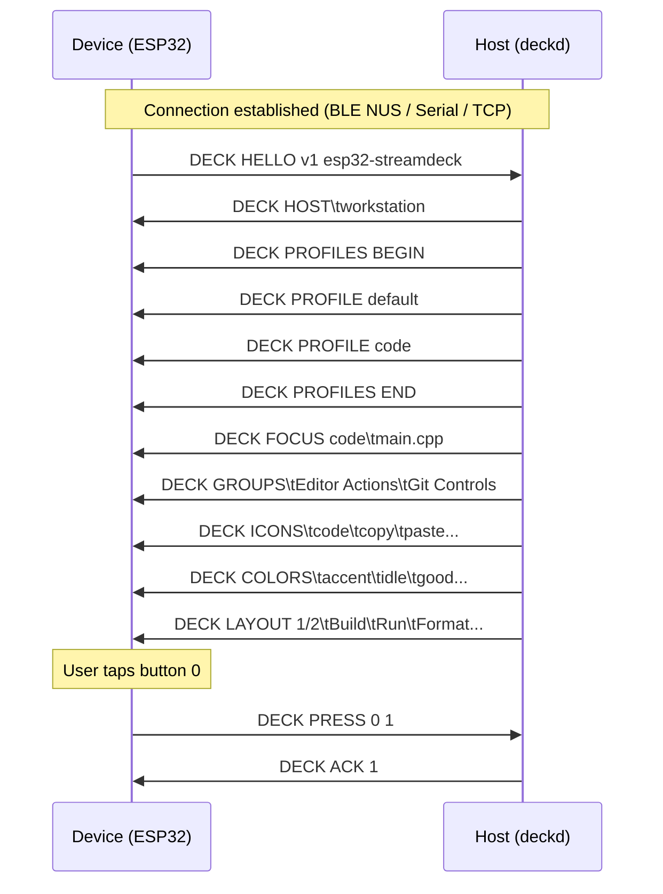

# Stream Deck Protocol Specification (`DECK`)

The `DECK` protocol is a newline-delimited (`\n`), UTF-8 line protocol designed to connect an external micro-controller or embedded device (such as an ESP32, ESP32-S3, or Raspberry Pi) to a Linux host running the `deckd` daemon.

It operates identically across three transport layers:
1. **Bluetooth Low Energy (BLE)** via Nordic UART Service (NUS):
   - Service UUID: `6E400001-B5A3-F393-E0A9-E50E24DCCA9E`
   - RX Char (Device -> Host write): `6E400002-B5A3-F393-E0A9-E50E24DCCA9E`
   - TX Char (Host -> Device notify): `6E400003-B5A3-F393-E0A9-E50E24DCCA9E`
2. **USB Serial / CDC** (at 115200 baud).
3. **TCP Socket** (port 4242 or advertised via mDNS as `_mmdeckd._tcp`).

---

## 1. Device → Daemon Commands

| Command | Arguments | Description |
|---|---|---|
| `DECK HELLO` | `v1 <deviceId>` | Handshake initiated by device upon connection. Identifies device. |
| `DECK PRESS` | `<buttonIndex> <seq>` | Button pressed by user (`buttonIndex` typically 0–15). `seq` is an incrementing sequence number for tracking acknowledgments. |
| `DECK PAGE NEXT` | *(none)* | Requests next page of buttons for the current profile. |
| `DECK PAGE PREV` | *(none)* | Requests previous page of buttons for the current profile. |
| `DECK SELECT\t` | `<profileId>` | Pins a specific profile override (e.g. `DECK SELECT\tcode`). Send empty (`DECK SELECT\t`) to revert to dynamic "Follow focus". |
| `DECK PONG` | `<nonce>` | Heartbeat reply echoing host's `DECK PING <nonce>`. |
| `DECK BATT` | `<pct> <mv>` | Optional battery telemetry from device. |

---

## 2. Daemon → Device Commands

| Command | Arguments | Description |
|---|---|---|
| `DECK HOST\t` | `<hostname>` | Informs device of connected computer identity. |
| `DECK FOCUS` | `<appId>\t<windowTitle>` | Active focused window changed on host (e.g., `code\tmain.cpp - VSCode`). |
| `DECK GROUPS\t` | `<group1>\t<group2>` | Titles for the two button groups (e.g. `Quick Launch\tMedia & Controls`). |
| `DECK ICONS\t` | `<icon0>\t<icon1>...` | Tab-delimited list of icon identifiers (e.g. `terminal\tfolder\tplay...`). |
| `DECK COLORS\t` | `<color0>\t<color1>...` | Tab-delimited list of semantic colors (`accent`, `good`, `bad`, `warn`, `idle`, or `#RRGGBB`). |
| `DECK LAYOUT` | `<page>/<pages>\t<label0>\t<label1>...` | Full idempotent layout push. Sets total pages and button labels. |
| `DECK ACK` | `<seq>` | Host confirmed action was dispatched for the button press with sequence `seq`. |
| `DECK ERR` | `<seq> <message>` | Press failed (e.g. unmapped button, uinput error). |
| `DECK PING` | `<nonce>` | Heartbeat sent periodically by daemon or device. |
| `DECK PROFILES BEGIN` | *(none)* | Starts transmission of available profile catalog. |
| `DECK PROFILE ` | `<profileName>` | Name of an available profile. |
| `DECK PROFILES END` | *(none)* | Finishes transmission of profile catalog. |
| `DECK SELECTED\t` | `<profileId>` | Notifies device of currently active override. |
| `DECK BYE` | `<reason>` | Daemon closing connection or rejecting device (e.g., host busy). |

---

## 3. Communication Flow

